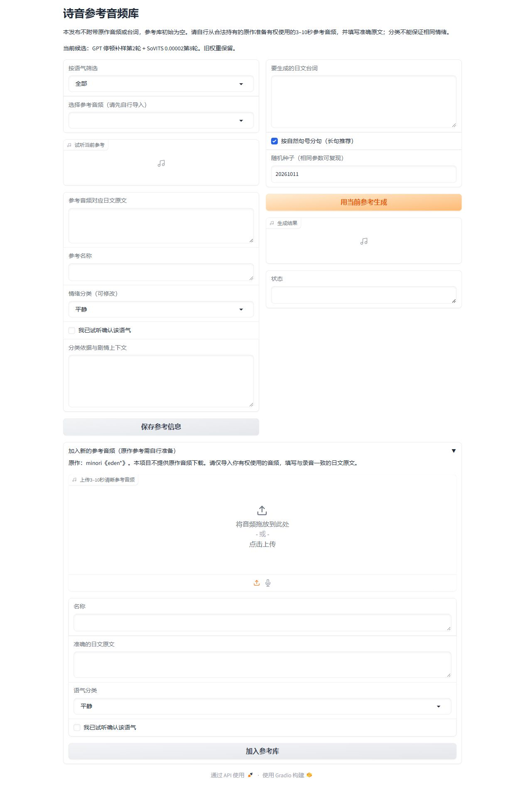

# eden* 诗音 GPT-SoVITS 语音模型

诗音（シオン / Sion）的日语语音模型，附带可自行导入音频的本地参考库界面。基于 GPT-SoVITS v2ProPlus；由游戏日文语音微调，用于角色语音生成实验。

## 下载：完整版已恢复15条参考音频

在[发布页](https://github.com/Lunona/eden-sion-gpt-sovits/releases/tag/v1.0.1)选择需要的版本：

|下载包|包含内容|首次使用|
|---|---|---|
|`sion-v1.0.1-full-15-references.zip`（完整版）|两份模型权重、15条参考音频、对应日文文本和分类、参考库界面、图文教程|启动后选已有参考、输入新台词、点击生成；无需先导入|
|`sion-v1.0.0-no-reference-audio.zip`（无参考音频版）|同一组模型权重与参考库界面，库为空|自行准备参考音频|

完整版恢复的是之前移除的全部15条参考，不是整个游戏的语音数据集。两种包都需要完整GPT-SoVITS环境，不包含Python、CUDA或主程序。GitHub的Source code下载仅含仓库源码，参考库仍为空；完整版请下载上述Release附件。

## 先看这里：不必先导入参考库

**模型可以直接在GPT-SoVITS普通推理界面使用，附带参考库是可选的管理工具。** 两种使用方式都需要选用参考音频；完整版已附带15条；不必先把它保存到参考库，也不需要重新训练模型。

- **直接使用模型**：下载两份权重，在GPT-SoVITS推理界面选择它们，直接上传3–10秒参考音频、填写对应日文原文，再输入新日文台词生成。
- **使用附带参考库**：完整版已预置15条，直接选择即可；只有无参考音频版的空库才需要先加入自己的参考。之后可筛选、试听和重复使用。

**“参考库可选”不等于“无需参考音频”。** 完整版已附带15条参考；无参考音频版与仓库源码不附带参考。工具不会自动下载原作素材。

## 从下载到生成：图文教程

👉 **[打开完整图文教程](docs/TUTORIAL.md)**：包含环境准备、普通推理界面直接使用、空参考库首次打开、上传与填写参考、输入新台词、生成播放器和下载结果。



教程的生成演示使用**单独新建的日语合成参考**，不是原作音频，也不是作者本地参考库。演示参考不会加入公开模型包。

## 下载与环境

在[Releases](https://github.com/Lunona/eden-sion-gpt-sovits/releases/tag/v1.0.1)下载上表对应的ZIP。完整版包含15条参考，无参考音频版为空库；两者都有两份权重、界面及说明。不含Python、CUDA、GPT-SoVITS主程序和通用预训练依赖；请先按[GPT-SoVITS官方项目](https://github.com/RVC-Boss/GPT-SoVITS)安装完整环境，配置v2ProPlus、日语文本前端及相应预训练依赖。

|模型|选择的文件|
|---|---|
|GPT|`models/sion-pause-supplement-lr002-e2.ckpt`|
|SoVITS|`models/sion-timbre-lr00002_e8_s1392.pth`|

参考语言和目标语言均选日语；参考文本应与参考录音一致。详细点击顺序见[教程方式A](docs/TUTORIAL.md#2-方式a不加入参考库直接生成)。GitHub的`Source code`压缩包只含源码，不能代替模型包。

已验证上游提交：`1b47ca07ef43a284e0b8bd7f29d3e1e3ff76082a`；附带参考库使用Gradio 4.44.1。其他上游版本的接口可能不同。

附带参考库启动方式（可选，Windows PowerShell；路径换成你的安装位置）：

```powershell
.\启动参考库.ps1 -AppPath "你的GPT-SoVITS程序目录" -Python "该完整环境的python.exe路径"
```

启动完成后，浏览器打开 http://127.0.0.1:9882/ 。仅监听本机，关闭启动终端可停止服务。首次加载模型较慢，请等启动完成。

参考路径相对于解压目录；附带参考库固定`speed=1`，未作额外调速或滤波。多个语气对应可切换的参考，不是混合多条参考，也不是只靠情绪标签控制。

## 发布组合

|部分|检查点|
|---|---|
|GPT|停顿补样，学习率0.002，第2轮|
|SoVITS|学习率0.00002，第8轮，1392步|

权重尺寸和 SHA256 见 `model-manifest.json`。SoVITS 的自定义文件头应通过 GPT-SoVITS 自带加载器读取，不能仅凭普通 torch.load 报错认定损坏。

## 效果与限制

同一句日文、同一参考、同一种子、原速比较：优化前／单结束标记第3轮／停顿补样第2轮的声纹余弦分别为0.8758／0.8998／0.9160，活动跨度相对原声误差分别15.9%／20.3%／11.5%。这些是单句指标，不是还原百分比。

开发集6句×2种子，三者声纹余弦均值分别0.8255／0.8374／0.8384，节奏误差中位数23.6%／16.8%／19.2%。发布组合的音色指标领先，但部分节奏指标由另一候选领先；不能宣称所有场景最好。此 GPT 组合尚未完成新的独立最终验收，之前其他组合的20条验收不等于本组合通过验收。

「一度」开头局部节奏和部分停顿仍有偏差；噪声与主观音色仍需试听判断。原声语义重建只用于诊断，不计入普通文本生成排名。

## 准备参考音频；保存进参考库是可选步骤

准备你有权使用的3–10秒、单一说话人、清晰完整的日语短句及对应准确原文。参考音频不限定必须来自原作；其他来源的参考可能改变声音与语气表现。本项目不提供原作音频下载、游戏安装包或提取素材。

在**普通GPT-SoVITS推理界面**，直接上传参考文件即可，不需要加入附带参考库。

在**完整版参考库界面**，可直接选择已有参考、输入新台词并生成。若使用空库版或要增加其他参考，展开“加入新的参考音频”，上传文件、填写名称与准确日文原文、选择语气分类，点击“加入参考库”；随后在左侧选中它、右侧输入新台词，点击“用当前参考生成”。[完整实际截图与操作顺序](docs/TUTORIAL.md#3-方式b附带参考库的实际图文操作)。

录音尽量避免BGM、其他说话人、严重噪声和截断句尾。分类只用于查找参考，实际语气迁移仍需试听判断。请勿把自行导入的原作音频随修改版本再次发布。

## 来源与许可

基于 [RVC-Boss/GPT-SoVITS](https://github.com/RVC-Boss/GPT-SoVITS)。本仓库公开参考库源码，作者代码及模型权重仅限非商业使用，见 `LICENSE` 及 [使用条款与免责声明](使用条款与免责声明.md)。第三方软件保留原许可证。

角色、游戏及原始语音来自 minori 的 eden*；相应权利属于原权利人。本项目不转授原游戏素材、角色、配音表演或第三方权利，也不代表原权利人授权。完整版Release附件包含模型权重、工具源码、15条原作参考音频及对应文本和分类说明；无参考音频版及仓库源码不含这些参考。两者均不包含CG、游戏安装包或完整游戏语音数据集。此发布不表示已取得原权利人的再分发授权。

## 免责声明与禁止商业用途

这是非官方个人实验，与原权利人及配音演员无官方合作或代言关系。禁止模型、素材及生成内容用于付费配音、广告、收费服务、商业产品或转售；禁止冒充真人、虚假代言及违法侵权用途。公开传播须标明 AI 合成。具体适用范围、第三方权利及免责声明见 [完整条款](使用条款与免责声明.md)。由于存在商业限制，本项目为非商业源码公开，不宣称 OSI 开源许可。

