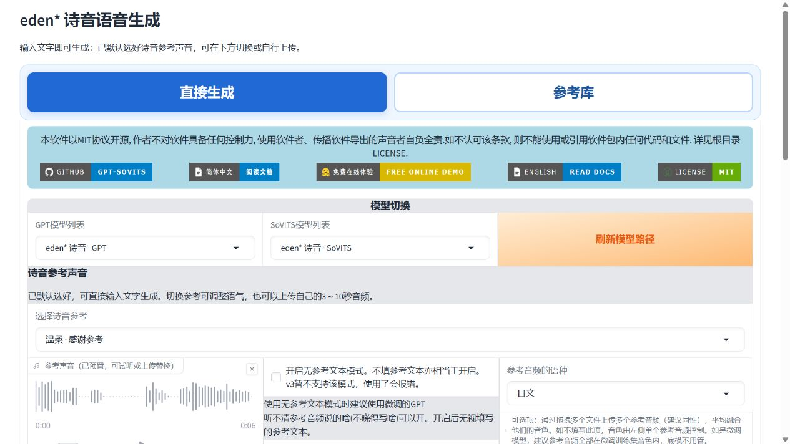
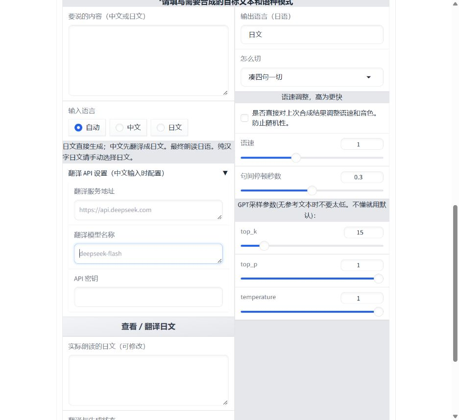

# eden* 诗音 GPT-SoVITS Windows 完整整合包

诗音（シオン / Sion）的日语语音模型与生成界面。**当前发布的是可独立运行的 Windows 完整整合包，已带 Python、GPT-SoVITS 主程序、PyTorch/CUDA 运行依赖、生成所需预训练模型、两份诗音权重和完整15条参考，无需另装 GPT-SoVITS。**

**GPT-SoVITS 原作者与团队：[RVC-Boss 及项目贡献者](https://github.com/RVC-Boss/GPT-SoVITS)，原项目许可证 [MIT](https://github.com/RVC-Boss/GPT-SoVITS/blob/main/LICENSE)。游戏、角色与原始声音：minori《eden*》。诗音模型微调、参考整理、配套页面与本整合包：Lunona。** 本包是非官方个人整合，各第三方组件保留自身版权和许可证，详见包内 `THIRD_PARTY_NOTICES.md`。

## 下载、解压、启动

1. 打开 **[完整整合包下载页](https://github.com/Lunona/eden-sion-gpt-sovits/releases/tag/v1.0.2)**，下载全部三个分卷：
   - `eden-sion-windows-portable.7z.001`
   - `eden-sion-windows-portable.7z.002`
   - `eden-sion-windows-portable.7z.003`
2. 把三个文件放在同一文件夹，用 [7-Zip](https://www.7-zip.org/) 打开 **.001** 并解压。分卷合起来是一套完整整合包；压缩文件总计约 **4.67 GiB**，解压后约 **10.74 GiB**。下载页附 `SHA256SUMS.txt` 与中文解压说明。
3. 双击解压目录内 **启动GPT-SoVITS.cmd**，等待服务加载后打开 [语音生成页面](http://127.0.0.1:9872/)。无需填写外部安装目录或复制模型。
4. 没有可用 NVIDIA 显卡时，用 **CPU模式启动.cmd**；用完双击 **停止GPT-SoVITS.cmd**。

适用 Windows 10 22H2 / Windows 11 64位。NVIDIA 加速需要兼容 CUDA 12.8 的显卡驱动；整合包中的 CUDA 运行依赖不能替代显卡驱动。本包用于语音生成，暂未包含完整训练工具、训练数据及额外的ASR/人声分离模型。

**GitHub 的 Source code 下载是仓库源码，不包含完整运行环境、模型权重或参考音频。请下载上面的三个 Release 分卷。** 旧版约307MB的轻量模型包已被本完整包替换，旧版的“先准备环境”步骤不再是整合包的使用前提。

## 输入文字即可生成

默认已加载诗音模型，并选好一条诗音参考声音。输入日文后点击 **合成语音**，不用先上传参考或加入参考库；日文生成不需要网络。

|入口|操作|
|---|---|
|直接生成|默认参考已选好；输入文字即可生成。同页可切换15条已有参考，也能自行上传3～10秒参考音频并填写准确原文。|
|参考库|筛选、试听已有15条参考，输入文字生成；也可加入、分类和保存自己的参考。|

生成流程仍会使用参考音频，程序已经替你选好。切换参考可调整说话细节；分类用于查找，不保证生成情绪完全符合分类。

## 中文输入与翻译 API

**两页均支持日文直接生成、中文翻译后生成日语音频。**

- **直接生成**：文本框下方的 **翻译 API 设置（中文输入时配置）** 默认展开。
- **参考库**：展开 **中文翻译设置（使用中文时配置）**。
- 填写服务地址、模型名和 API 密钥，点击 **查看／翻译日文**。可以修改实际朗读的日文，再点击生成。
- 也可以直接点击生成，中文会先翻译，日文绕过翻译；未配置中文翻译或翻译失败时停止，不会退回念中文。
- 纯汉字日文和混合语言请手动选择输入语言。不会内置或自动下载翻译模型。

DeepSeek 配置示例：地址 `https://api.deepseek.com`，模型 `deepseek-flash`，密钥填写自己的 API Key。示例仅是输入提示，未预设服务或密钥。密钥不保存到启动设置、参考库或生成记录；关闭后需重新填写。在线翻译会将输入文字发送给所选服务。

👉 [从下载到生成的图文教程](docs/TUTORIAL.md) · [中文输入说明](docs/CHINESE_INPUT.md) · [替换旧版](docs/UPGRADE.md)

## 包含的模型与参考

- `models/eden_诗音_Sion_GPT.ckpt`：GPT 停顿补样第2轮。
- `models/eden_诗音_Sion_SoVITS.pth`：SoVITS 学习率0.00002，第8轮。
- 15条完整参考、对应日文文本和分类；与此前完整版相同。

模型仅改为可识别的文件名，权重内容未变。SHA256 见 `model-manifest.json`；参考校验见 `reference-manifest.json`。模型列表保留可用的官方底模，不展示作者的中间训练检查点。

## 验证与效果范围

完整独立环境的CPU及NVIDIA GPU生成、MP3参考导入、默认参考和切换参考、移动到含中文和空格目录后运行均已验证。三个发布分卷通过完整性检查，GitHub文件大小和SHA256与本地一致。统一入口、页签切换、启动和停止已在 Windows 环境验证。直接生成已实际生成日文音频、通过本机固定响应翻译接口将中文转成日文后生成，以及修改译文后生成；这些是流程验证，不是翻译质量评测。语音模型仍有音色、停顿与节奏限制，不保证原声完全还原。

## 来源与许可

基于 [RVC-Boss/GPT-SoVITS](https://github.com/RVC-Boss/GPT-SoVITS)。本仓库公开参考库源码，作者代码及模型权重仅限非商业使用，见 `LICENSE` 及 [使用条款与免责声明](使用条款与免责声明.md)。第三方软件保留原许可证。

角色、游戏及原始语音来自 minori 的 eden*；相应权利属于原权利人。本项目不转授原游戏素材、角色、配音表演或第三方权利，也不代表原权利人授权。完整版Release附件包含运行环境、模型权重、工具源码、15条原作参考音频及对应文本和分类说明；仓库源码不含参考音频、模型权重和完整运行环境。发布内容不包含CG、游戏安装包或完整游戏语音数据集。此发布不表示已取得原权利人的再分发授权。

## 免责声明与禁止商业用途

这是非官方个人实验，与原权利人及配音演员无官方合作或代言关系。禁止模型、素材及生成内容用于付费配音、广告、收费服务、商业产品或转售；禁止冒充真人、虚假代言及违法侵权用途。公开传播须标明 AI 合成。具体适用范围、第三方权利及免责声明见 [完整条款](使用条款与免责声明.md)。由于存在商业限制，本项目为非商业源码公开，不宣称 OSI 开源许可。

