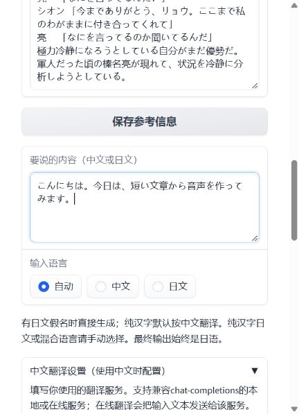
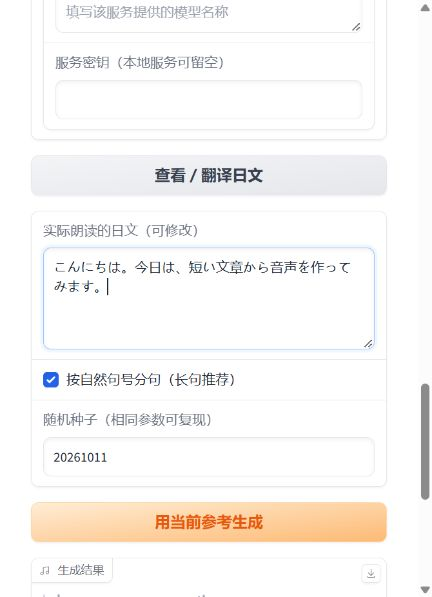

# 中文输入，日语输出（v1.0.2）

语音模型仍然只按日语生成。新增的文字翻译是独立步骤，不需要把翻译模型放进诗音模型包。

## 使用顺序

1. 在“要说的内容（中文或日文）”输入内容。
2. “输入语言”可选自动、中文、日文。自动模式检测到日文假名就直接生成；没有假名且有汉字时按中文翻译。**纯汉字日文、中文里夹日文或其他混合语言，请手动选择，不能保证自动识别准确。**
3. 日文不需要翻译服务。中文需先展开“中文翻译设置”，填写服务地址、实际模型名称和所需密钥。
4. 可以直接点“用当前参考生成”：中文先翻译，日文直接生成。也可以先点“查看／翻译日文”，检查“实际朗读的日文”，修改措辞后再生成。
5. 生成结果始终是日语。输入内容、输入语言或翻译设置变化时，旧译文和旧结果会清除，防止生成上一句的内容。

以下为新版界面的实际截图（窄窗口上下排列，展示日文直接生成的操作）：

## 翻译服务稍后配置也可以

当前没有预选或内置翻译服务。未配置时，日文仍可正常生成；输入中文会提示配置服务，不会把中文当日文送进语音模型。

服务需兼容`chat-completions`请求与响应格式。服务地址填写其API基础地址（通常以`/v1`结尾），也可以填写完整`/chat/completions`地址。例如，已部署的本机Ollama服务可填写`http://127.0.0.1:11434/v1`，模型名必须是自己实际安装的模型；这只是地址示例，程序不会安装或下载模型。接口格式见[Ollama官方说明](https://docs.ollama.com/api/openai-compatibility)。

在线服务使用HTTPS；HTTP只允许本机回环地址。在线翻译会把输入文本发送到用户选择的服务，并可能产生该服务的费用。日文直接生成时不发起翻译请求。设置和密钥只用于当前运行，不写入下载包、参考库或生成参数记录；重开后需重新填写。请求失败、认证失败、超时、空译文或明显不是日文时会停止生成，不会静默退回原中文。

## 当前已验证的范围

- 12项自动测试覆盖日文跳过翻译、中文经过接口再调用语音生成、语言手动选择、失败时停止、修改译文生效、输入变化后丢弃旧译文，以及生成记录不保存服务密钥。
- 自动测试中的翻译接口为本机固定响应测试服务，用于验证流程，**不是实际翻译模型效果测试**。
- 新界面已实际用附带参考跑通日文直接生成，输出5.32秒音频；未配置服务的中文输入已实测提示配置并停止。
- 真实翻译服务尚未配置，因此中译日的准确度、角色措辞和稳定性仍需接入所选服务后检验。

翻译提示词要求忠实保留人名、数字、否定、称呼和语气，输出自然的日语对话。这是要求，不保证服务每次都满足；生成前查看译文仍然有帮助。
