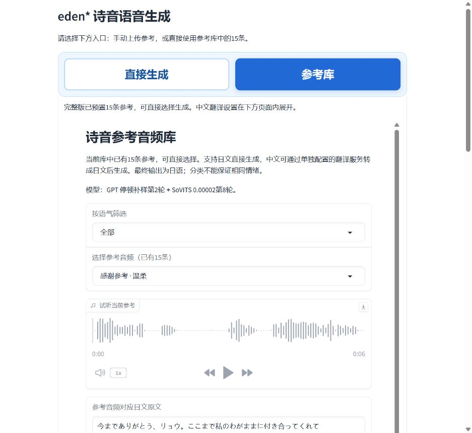

# 首次使用：准备 GPT-SoVITS 环境并导入诗音模型

## 先认清下载的是什么

本站约307MB的诗音包包含 **诗音的两份微调权重、15条参考音频和对应日文原文、配套界面**。它不是 GPT-SoVITS 完整环境，不包含运行用的 Python、PyTorch/CUDA、主程序和通用预训练依赖。

你需要两部分：

|下载内容|来自哪里|用途|
|---|---|---|
|完整 GPT-SoVITS 环境|原作者项目 RVC-Boss/GPT-SoVITS 提供的安装说明与整合包入口|运行程序、加载通用依赖|
|诗音模型包|本项目 Releases 的 sion-v1.0.2-full-15-references.zip|加载诗音声音、提供15条参考和配套界面|

**GPT-SoVITS 原项目：RVC-Boss 及项目贡献者。** 原项目链接：[RVC-Boss/GPT-SoVITS](https://github.com/RVC-Boss/GPT-SoVITS)；[原作者中文安装说明](https://github.com/RVC-Boss/GPT-SoVITS/blob/main/docs/cn/README.md)；[原项目 MIT 许可证](https://github.com/RVC-Boss/GPT-SoVITS/blob/main/LICENSE)。本项目不是 GPT-SoVITS 原作者或官方发行版。

**游戏与角色原作：minori《eden*》。** 诗音角色、原始配音音频、文本等第三方权利属于原权利人。**诗音模型微调、参考整理、配套页面与本教程：Lunona，本项目发布者。** 本项目的非商业条款不改变上游 GPT-SoVITS 的 MIT 许可证，也不转授原作素材权利。[来源与完整条款](../使用条款与免责声明.md)。

## 一、先安装完整环境（Windows）

1. 打开[原作者中文说明](https://github.com/RVC-Boss/GPT-SoVITS/blob/main/docs/cn/README.md#安装)，从其中的 Windows 下载入口获取完整环境。也可打开维护者的[Windows 整合包列表](https://huggingface.co/lj1995/GPT-SoVITS-windows-package/tree/main)，或[原项目说明链接的国内下载页](https://www.yuque.com/baicaigongchang1145haoyuangong/ib3g1e/dkxgpiy9zb96hob4#KTvnO)。这些环境由原项目维护者发布，本项目不重新上传或冒充作者。
2. 按显卡与维护者说明选包。维护者目前提供 GPT-SoVITS-v5-20261005.7z 与标有 nvidia50x0 的对应包等版本；文件名叫v5不表示只能加载v5模型。**必须确认里面支持 v2ProPlus，并按原项目说明准备该版本依赖。** 本项目已验证的程序提交为 1b47ca07ef43a284e0b8bd7f29d3e1e3ff76082a、Gradio 4.44.1；未逐一测试维护者的每个整合包。
3. 用7-Zip等工具完整解压到固定目录。假设解压后的程序目录是 `D:\AI\GPT-SoVITS`（示例位置，不是要求你一定放这里）。这个目录里应能看到 `GPT_SoVITS`、`webui.py`、`go-webui.bat` 等文件；部分环境会把这些放在内层 `app` 目录。
4. 按原作者说明运行 `go-webui.bat`，先确认原版主页面能打开。在版本选择处确认能选择 **v2ProPlus**。主页面不是语音结果页，后面还要进入TTS推理。
5. 如果缺少预训练文件，按原作者 README 的[预训练模型说明](https://github.com/RVC-Boss/GPT-SoVITS/blob/main/docs/cn/README.md#预训练模型)补齐到其指定目录。不要把诗音权重拿去替换整个 pretrained_models 文件夹；也不用先训练诗音。

使用已有、可正常生成的 v2ProPlus 环境，可以跳过上面安装步骤。环境新版本的界面和依赖可能不同，以原项目说明为准。

## 二、路线A：导入原版 GPT-SoVITS v2ProPlus

这条路线只用原版软件，不要求使用本项目的参考库或启动器。

1. 下载并解压[诗音完整版](https://github.com/Lunona/eden-sion-gpt-sovits/releases/tag/v1.0.2)。进入诗音包的 `models` 文件夹，找到：
   - `eden_诗音_Sion_GPT.ckpt`
   - `eden_诗音_Sion_SoVITS.pth`
2. 找到完整环境的**程序目录**：即包含 `GPT_SoVITS` 与 `webui.py` 的目录。将两个文件分别复制到以下目录，不要放反：

|诗音权重文件|放进完整环境的目录|
|---|---|
|eden_诗音_Sion_GPT.ckpt|GPT_weights_v2ProPlus|
|eden_诗音_Sion_SoVITS.pth|SoVITS_weights_v2ProPlus|

目录不存在时在程序目录里新建。以示例目录为例，完成后是：

```text
D:\AI\GPT-SoVITS\
├─ webui.py
├─ GPT_SoVITS\
├─ GPT_weights_v2ProPlus\
│  └─ eden_诗音_Sion_GPT.ckpt
└─ SoVITS_weights_v2ProPlus\
   └─ eden_诗音_Sion_SoVITS.pth
```

3. 打开原版主页面，版本选择 **v2ProPlus**；进入 **1-GPT-SoVITS-TTS → 1C-推理**，点击开启 **TTS推理WebUI** 的按钮。不同版本文字稍有不同，以该环境实际界面为准。只停留在“0-前置数据集获取工具”不是生成页面。
4. 在推理页面点击 **刷新模型路径**。GPT模型列表选择文件名含 `eden_诗音_Sion_GPT.ckpt` 的那项；SoVITS模型列表选择含 `eden_诗音_Sion_SoVITS.pth` 的那项。没有出现时检查复制目录，并刷新或重启推理界面。不要用“不训练直接推……底模”代替已训练的诗音权重。
5. 上传3–10秒参考音频、填写这条参考的准确日文原文，参考语言选 **日文**。可用诗音包 `curated` 中的参考，并从 `references.json` 查对应原文；已有15条不等于程序会自动替你选参考。
6. 在目标文本栏输入**新日文台词**，目标语言选 **日文**，语速先保持1，再点击 **合成语音**。两份文件是训练好的模型，不需要先重训。

原版界面没有本项目新增的中文翻译API入口。若想中文输入后转日文生成，或在同一页使用15条参考库，请用下面路线B。

## 三、路线B：用诗音包的统一页面自动加载

这条路线仍需要上面的完整环境，但**不用手动复制模型进原版的权重目录**。

1. 先关闭占用9872、9882端口的旧推理/参考库服务，再在诗音包第一层双击 **启动GPT-SoVITS.cmd**。
2. 首次提示安装目录时，粘贴完整环境的路径，如 `D:\AI\GPT-SoVITS`；如果程序在 `app` 内层，也可以直接填写那个 `app` 目录。不要填写诗音包的 models 文件夹、某个模型文件或网页网址。
3. 启动器自动查找完整环境的 Python。找不到时，按提示填写该环境实际使用的 `python.exe`，例如 `runtime\python.exe` 或 `venv\Scripts\python.exe` 的完整路径，不要填写电脑上另一个无依赖的Python。
4. 加载完成后自动打开 http://127.0.0.1:9872/ 。程序直接加载诗音包 models 内的两份权重，顶部切换 **直接生成** 与 **参考库**。如果系统未打开浏览器，复制网址到浏览器地址栏。
5. **直接生成**需要手动上传参考；**参考库**直接选择已有15条。两页都有翻译API配置，日文直接生成，中文配置翻译服务后先译成日文再生成。
6. 用完双击诗音包第一层的 **停止GPT-SoVITS.cmd**。




详细生成操作见[图文教程](TUTORIAL.md)。

## 常见问题

- **只有诗音模型吗？** 本包只有诗音角色微调权重与配套工具；完整环境的原作者基础模型和依赖另由该环境提供。
- **v2ProPlus是另一个需要导入的诗音模型吗？** 它是GPT-SoVITS的模型架构/版本。先有支持它的软件环境，再加载诗音的GPT与SoVITS权重。
- **为什么找到环境还提示没有某个模块？** 可能选到了无依赖的系统Python或环境依赖未安装；按原项目说明修复该完整环境。配套界面已验证Gradio4.44.1，其他版本的界面接口需核对，不要盲目升级依赖覆盖原环境。
- **是否必须导入参考库？** 不必。路线A直接上传参考；路线B参考库预置15条可选择。两种方式都需要参考音频。

资料核对日期：2026-10-13。安装入口与原版路径来自原项目说明和config；本项目的统一启动器已在本机环境测试，不表示所有第三方整合包均已验证。
