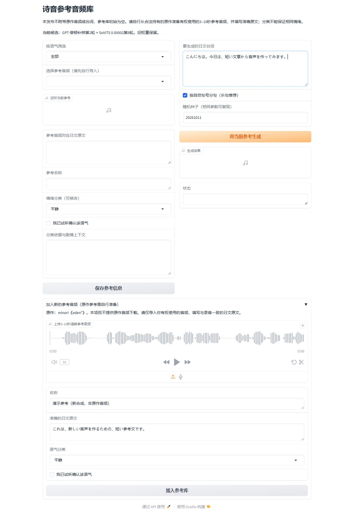
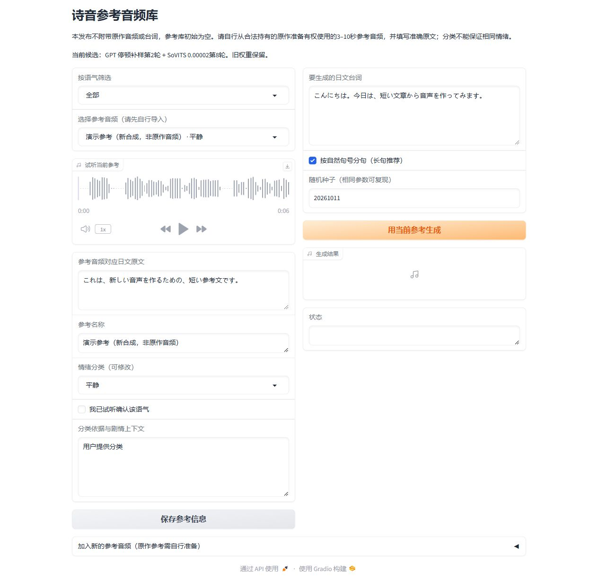
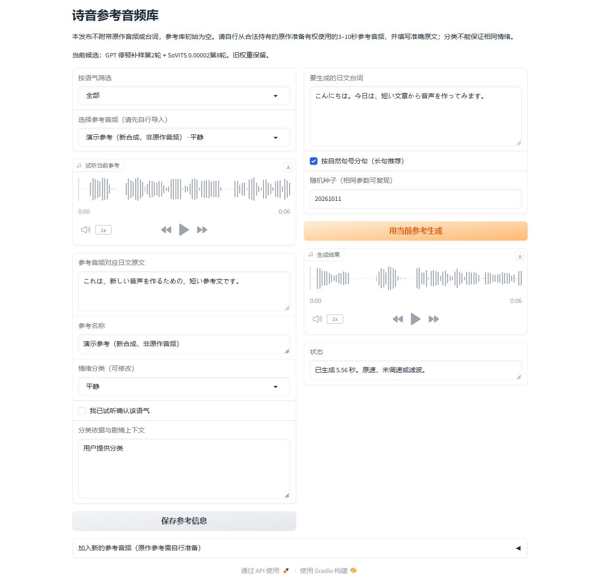

# 诗音模型使用教程：从下载到文字生成音频

本教程对应公开的**无参考音频发布版**。模型下载包不附带原作音频，参考库初始为空。

**不必先导入参考库才能使用模型。** 你可以选下面任意一种方式：

|方式|适合谁|是否需要加入参考库|
|---|---|---|
|A：GPT-SoVITS普通推理界面|已经装好GPT-SoVITS，想直接加载模型生成|不需要；在推理界面直接上传参考音频|
|B：附带的参考库界面|想保存参考、按语气查找，之后重复使用|此界面从库中选择参考，首次使用需自行添加一条|

两种方式都需要参考音频。**“参考库可选”不等于“无需参考音频”。** 当前公开模型和附带界面按参考音频进行生成；音频提供说话方式等参考，模型权重负责生成新的台词。

## 1. 下载和环境准备

1. 到[发布下载页](https://github.com/Lunona/eden-sion-gpt-sovits/releases)下载 `sion-v1.0.0-no-reference-audio.zip`。不要把GitHub自动生成的`Source code`压缩包当成模型包；源码压缩包不包含模型权重。
2. 解压到自己的工作目录。确认`models`目录里有以下两个文件，文件名保持不变：
   - GPT：`sion-pause-supplement-lr002-e2.ckpt`
   - SoVITS：`sion-timbre-lr00002_e8_s1392.pth`
3. 安装完整的[GPT-SoVITS官方环境](https://github.com/RVC-Boss/GPT-SoVITS)，确保支持`v2ProPlus`，并按官方说明配置日语及通用预训练依赖。**这个模型包不是独立运行的整合包**，不包含Python、CUDA或GPT-SoVITS主程序。安装流程随上游变化，以官方说明为准。
4. 准备一段你有权使用的3–10秒清晰日语参考，以及与录音一致的日文原文。不要用中文翻译代替参考文本，也不要把要生成的新台词填到参考文本栏。

参考音频不限定必须来自原作；使用其他来源或合成参考时，声音和说话方式可能变化。为了试听诗音模型的角色效果，尽量选与目标声音接近的参考。完整句子、单一说话人、无明显BGM与噪声的音频更容易核对。

## 2. 方式A：不加入参考库，直接生成

1. 在完整GPT-SoVITS环境中打开**TTS推理界面**，选择支持本模型的`v2ProPlus`版本。
2. 将模型包里的`.ckpt`复制到该环境的`GPT_weights_v2ProPlus`目录，将`.pth`复制到`SoVITS_weights_v2ProPlus`目录。目录不存在时自行创建；不同整合包的布局可能不同，以其模型路径设置为准。
3. 在推理界面点击**刷新模型路径**，分别选择这两份GPT和SoVITS权重。这里是加载已经训练好的模型，**不用重新训练**。
4. 在**请上传3~10秒内参考音频**处直接选择你的参考文件。在**参考音频的文本**处填写这段录音的准确日文，并把参考语言选为**日语**。
5. 在目标文本栏输入新日文台词，目标语言也选**日语**。例如可以自己写：

   > こんにちは。今日は、短い文章から音声を作ってみます。

   这只是原创目标文本示例，不是参考录音的原文。
6. 语速先保持`1`，其余参数先使用默认值。点击**合成语音**，等待输出播放器出现，再播放和下载结果。

**此流程不使用附带参考库，也不要求点击“加入参考库”。** 若模型没出现在列表中，先检查复制目录与文件后缀，再刷新或重启推理界面。

## 3. 方式B：附带参考库的实际图文操作

### 打开公开版空参考库

在解压目录打开PowerShell，用自己的安装位置替换下面两处路径：

```powershell
.\启动参考库.ps1 -AppPath "D:\GPT-SoVITS" -Python "D:\GPT-SoVITS\runtime\python.exe"
```

`-AppPath`应指向含`GPT_SoVITS/inference_webui.py`的GPT-SoVITS根目录；`-Python`应指向这个完整环境实际使用的Python，不一定与示例路径相同。等启动完成后，浏览器打开 `http://127.0.0.1:9882/`。

下面是真实公开版界面截图。首次打开时参考下拉框和播放器为空，**这是无参考音频包的正常状态，不是模型损坏**。


### 上传参考并填写对应原文

展开**加入新的参考音频（原作参考需自行准备）**：

1. 点击音频上传区，选择3–10秒参考。
2. **名称**：写一个自己容易辨认的名字。
3. **准确的日文原文**：填写录音里实际说的话。
4. **语气分类**：用于之后筛选，不能只靠这个标签把声音变成对应情绪。
5. 点击**加入参考库**。成功后，左上参考下拉框会选中这条，左侧播放器可试听，状态显示**已加入参考库。**

**截图中的“演示参考（新合成，非原作音频）”是为拍教程单独新建的日语合成录音，不是原作音频，不来自作者本地参考库，也不包含在公开下载包中。用户应选择自己的参考，并填写自己的录音原文，不要照抄示例原文去配其他音频。**



### 输入新台词，点击生成

左侧确认已选参考。右侧**要生成的日文台词**输入你希望模型新说的话。它与左侧“参考音频对应日文原文”是两段不同的内容。

示例输入：

> こんにちは。今日は、短い文章から音声を作ってみます。

长句可以保留**按自然句号分句（长句推荐）**。第一次先保留默认种子，然后点击橙色按钮**用当前参考生成**。首次生成需加载模型，比后续等待更久；不要连续重复点击。



### 播放和下载生成结果

生成成功后，右侧**生成结果**出现带时长的播放器，**状态**显示生成秒数。点击播放试听；播放器的下载图标可保存音频。原始结果和参数记录也保存在这个参考库目录的`generated`文件夹。



这里展示的是操作流程。演示参考为通用合成声音，**不能把这一次演示当作原作音色还原测试**。

## 4. 常见问题

|遇到的问题|先检查什么|
|---|---|
|参考库为空|公开包默认就是空库；使用方式A可直接上传参考，使用方式B先加入一条自己的参考|
|“请选择一条参考音频”|方式B左侧还未选中已加入的参考|
|参考音频时长报错|是否在3–10秒之间，是否截断句子|
|“请设置GPT_SOVITS_APP”|`-AppPath`是否指向完整GPT-SoVITS根目录，而不是模型包目录|
|模型加载失败或找不到文件|两份权重是否完整，模型版本是否支持v2ProPlus，官方预训练依赖是否齐全；可对照`model-manifest.json`校验|
|生成文字读错、停顿不自然|先核对参考文本与录音一致、两种语言均为日语；长句分句，使用清晰短参考重新试听|
|换语气分类但声音没变|分类是查找标签；要切换实际参考录音，标签不能保证情绪迁移|
|端口被占用|先确认是否已有自己的参考库在运行，不要随意关闭其他程序；这个工具默认监听本机9882|

附带参考库固定`speed=1`，不作额外调速或滤波。模型仍有音色、停顿和节奏限制，实际效果以试听为准。

## 来源与使用范围

原作：minori《eden*》。本项目是非官方个人实验，公开包不含原作音频、台词、CG或游戏安装包。模型、作者代码及生成内容仅限非商业用途；对外传播须标明AI合成。完整说明见[使用条款与免责声明](https://github.com/Lunona/eden-sion-gpt-sovits/blob/main/使用条款与免责声明.md)。
